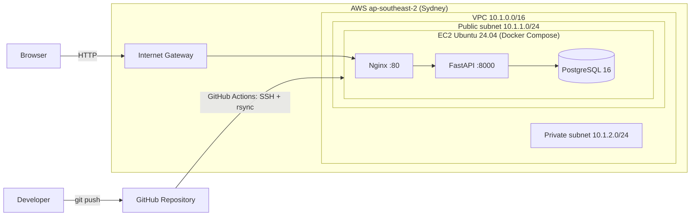

# Cloud DevOps Project on AWS


A containerized web application deployed on AWS. The infrastructure is created with **Terraform** (Infrastructure as Code), and every push to `main` is deployed automatically by a **GitHub Actions** CI/CD pipeline.

---

## Architecture



## Tech Stack

| Area | Tools |
|------|-------|
| Cloud | AWS VPC, public/private subnets, Internet Gateway, route tables, Security Groups, EC2 |
| Infrastructure as Code | Terraform |
| Containers | Docker, Docker Compose |
| Backend | Python, FastAPI, Uvicorn, psycopg2 |
| Database | PostgreSQL 16 (persistent Docker volume) |
| Web server | Nginx (reverse proxy) |
| CI/CD | GitHub Actions (SSH, rsync, Docker Compose) |

## Features

- Entire network and server created from code with `terraform apply`, and removed with `terraform destroy`
- Three containers started with a single `docker compose up`
- Database health check, so the API starts only after PostgreSQL is ready
- Automatic deployment on every push to `main`
- Post-deploy health check (`/health`) that fails the pipeline if the app is down
- Secrets kept out of Git (`.env`, `.pem` and Terraform state are in `.gitignore`)

## API Endpoints

| Endpoint | Description |
|----------|-------------|
| `GET /` | Returns a status message |
| `GET /health` | Health check used by the pipeline |
| `GET /visits` | Increments and returns a visit counter stored in PostgreSQL |

## CI/CD Pipeline

1. Developer pushes code to `main`
2. GitHub Actions checks out the code and sets up the SSH key from repository secrets
3. `rsync` copies the project to the EC2 server
4. `docker compose up -d --build` rebuilds and restarts the containers
5. A health check calls `/health` and fails the run if the app does not respond

Required repository secrets: `EC2_HOST`, `EC2_SSH_KEY`

## Project Structure

```
.
├── app/                    FastAPI application and Dockerfile
├── nginx/                  Nginx reverse proxy configuration
├── terraform/              VPC, subnets, route table, security group, EC2
├── docker-compose.yml      Nginx + FastAPI + PostgreSQL stack
└── .github/workflows/      GitHub Actions deploy pipeline
```

## Run Locally

```bash
# 1. Create a .env file
cat > .env << 'EOF'
POSTGRES_DB=appdb
POSTGRES_USER=appuser
POSTGRES_PASSWORD=change_me
EOF

# 2. Start the stack
docker compose up -d --build

# 3. Test
curl localhost
curl localhost/visits
```

## Provision the Infrastructure

```bash
cd terraform
echo 'my_ip = "YOUR_IP/32"' > terraform.tfvars
terraform init
terraform plan
terraform apply
```

Terraform creates 8 resources: VPC, Internet Gateway, public and private subnets, route table and association, security group, and an EC2 instance that installs Docker on first boot.

## Screenshots

> Add your screenshots to a `docs/` folder and link them here.

| GitHub Actions (successful run) | Live app (`/visits`) |
|---|---|
|  |  |

## Security Notes

- SSH access is controlled by a security group and key-based login only (no passwords)
- Database credentials are generated randomly and stored only on the server in `.env`
- The database container is not exposed to the internet, only Nginx listens on port 80
- Possible improvements: HTTPS with a domain and Let's Encrypt, AWS SSM instead of open SSH, remote Terraform state in S3, CloudWatch monitoring

## Author

**Chathurika Liyanage**
BICT (Hons) in Networking Technology, University of Sri Jayewardenepura

[GitHub](https://github.com/chathurikamadhuwanthi) · [LinkedIn](https://www.linkedin.com/in/chathurika-madhuwanthi)
